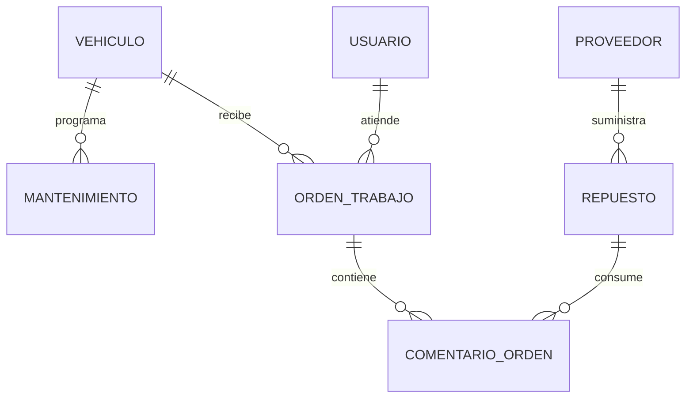

# Documentacion tecnica

## Contexto

API REST para administrar una flota vehicular y el flujo de atencion de un taller.
Los catalogos de proveedores, repuestos, vehiculos y mantenimientos alimentan las ordenes de trabajo. El operador registra el servicio y consume repuestos; el sistema descuenta existencias y acumula el costo de la orden.

## Modulos

| Modulo | Entrada principal | Salida y relacion |
|---|---|---|
| Vehiculos | placa, datos del vehiculo y kilometraje | Vehiculo disponible para mantenimientos y ordenes |
| Mantenimientos | vehiculo, descripcion, kilometraje objetivo | Programacion asociada a un vehiculo |
| Proveedores | cedula, nombre y contacto | Proveedor de repuestos |
| Inventario | codigo, precio, stock y proveedor | Repuestos y resumen valorizado |
| Ordenes de trabajo | vehiculo, falla, estado y mecanico | Servicio activo o cerrado |

## Diagrama ER

Relaciones: proveedor-repuesto, vehiculo-mantenimiento y vehiculo-orden son 1:N. La relacion entre ordenes y repuestos es N:M mediante `ComentarioOrden`. Los proveedores y repuestos relacionados usan borrado protegido; los detalles de una orden se eliminan con su orden.

## Matriz de permisos

| Operacion | Administrador | Operador | Consulta | Anonimo |
|---|---:|---:|---:|---:|
| Consultar recursos | Si | Si | Si | 401 |
| Crear o modificar catalogos | Si | No (403) | No (403) | 401 |
| Crear o modificar ordenes | Si | Si | No (403) | 401 |
| Eliminar ordenes, repuestos o proveedores | Si | No (403) | No (403) | 401 |
| Registrar consumos | Si | Si | No (403) | 401 |
| Consultar resumen de inventario | Si | Si | Si | 401 |

## Reglas de negocio

1. La placa es unica y se normaliza a mayusculas sin espacios.
2. El kilometraje objetivo supera el kilometraje actual, incluso en `PATCH`.
3. Un vehiculo solo tiene una orden activa.
4. Una orden completada o cancelada no se puede modificar.
5. Completar una orden requiere fecha de salida.
6. La fecha de salida no puede anteceder a la fecha de ingreso.
7. El costo total nunca es negativo.
8. Solo se agregan repuestos a ordenes activas.
9. El consumo no puede superar el stock disponible.

Las validaciones responden 400. Los borrados bloqueados por relaciones responden 409.

## Catalogo de endpoints

- `POST /api/auth/login/`, `POST /api/auth/logout/`, `GET /api/auth/perfil/`
- `GET|POST /api/vehiculos/`, `GET|PUT|PATCH|DELETE /api/vehiculos/<id>/`
- `GET|POST /api/mantenimientos/`, `GET|PUT|PATCH|DELETE /api/mantenimientos/<id>/`
- `GET|POST /api/proveedores/`, `GET|PUT|PATCH|DELETE /api/proveedores/<id>/`
- `GET|POST /api/inventario/`, `GET|PUT|PATCH|DELETE /api/inventario/<id>/`
- `GET /api/inventario/resumen/`, `POST /api/inventario/consumos/`
- `GET|POST /api/ordenes/`, `GET|PUT|PATCH|DELETE /api/ordenes/<id>/`
- `GET|POST /api/comentarios/`, `GET|DELETE /api/comentarios/<id>/`

Los listados usan paginacion. Inventario permite busqueda, filtros combinables y ordenamiento; vehiculos y mantenimientos permiten filtros por estado, kilometraje o vehiculo.

## Flujo solicitud a respuesta

`solicitud -> autenticacion/permisos -> vista -> serializador o servicio -> ORM -> respuesta HTTP`

El consumo de inventario se ejecuta en una transaccion atomica y actualiza stock y costo de la orden.
